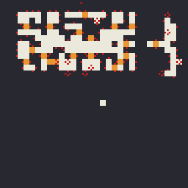

# Lands of Lore I: file formats and game rules

*Lands of Lore: The Throne of Chaos* is a first-person role-playing game for DOS by Westwood Studios (1993; CD-ROM edition with speech later). This repository explains how its data files and its rules work, and gives you Python tools that read every file type from your own copy of the game.

It contains documentation, tools and small tables of numbers. It contains no game files and no dumps of game pictures, sounds or text; the only game-derived images are three small examples in `examples/`.



*Level 12 drawn from its map file alone (`tools/level_renderer.py --level 12 --schematic`): open squares light, walls dark, doors and switches orange, decorated walls marked red.*

## What you get

- **One page per file format** in [`docs/formats/`](docs/formats/README.md): layout, a worked example with real bytes, which part of the game reads it, and how it was checked.
- **How the game works**: [`docs/HOW_THE_GAME_WORKS.md`](docs/HOW_THE_GAME_WORKS.md), with the details in [scripts](docs/emc2_scripts.md), [rules](docs/game_rules.md), [tables in the program](docs/executable_tables.md) and [save files](docs/savegame_format.md).
- **Tools** in [`tools/`](tools/README.md): a reader for every format, map and sprite renderers, a script disassembler, text and sound extractors. Each has `--help`, writes only where you tell it, and has a `--check` that tests it against every file of its kind.
- **[Level sheets](docs/levels/README.md)**: one page per level, made from its files: graphics, wall types, clickable walls, every script entry with a one-line description, items and monsters placed, automap legend.
- **[Start here, by goal](docs/START_HERE.md)** and a **[glossary](docs/GLOSSARY.md)**.

## Quick start (5 minutes)

You need Python 3.8+ and your own copy of the DOS game (CD or floppy edition).

```bash
git clone https://github.com/KForestland/lands-of-lore-1-re.git
cd lands-of-lore-1-re
python3 -m venv .venv && . .venv/bin/activate
pip install -r requirements.txt                 # Pillow, for PNG output
export LOL1_DATA=/path/to/your/LOL1/DATA        # the game's DATA folder
python3 tools/check_all.py                      # 26 checks, ends with ALL 26 CHECKS PASSED
python3 tools/level_renderer.py --level 1 --out-dir maps/ --schematic
python3 tools/decode_dialogue.py LEVEL01.ENG --index 0
```

The last command prints the first line of level 1's English text: `[0] Welcome to Gladstone Keep.  King Richard awaits you in the throne room.`

## Status

Full table with evidence: [`docs/STATUS.md`](docs/STATUS.md). Open questions: [`docs/OPEN_QUESTIONS.md`](docs/OPEN_QUESTIONS.md).

| Area | State |
|------|-------|
| Archives, compression, pictures, sprites, animations, sound, fonts, text | Documented, readers, checked on every file of both editions read |
| Level maps (CMZ, WLL, VCN/VMP, decorations, automap legend) | Documented, readers and renderer, checked on every file; a few bytes open (Q3, Q11) |
| Level and item scripts (EMC2), cut-scene scripts (TIM) | Documented with full opcode and function tables; all 60 scripts of both editions and the 139 TIM files of the CD checked |
| Tables inside the program, save files | Documented and checked in both executables and on save files |
| Game rules (combat, magic, experience, monsters, light, time) | Written; the core combat arithmetic is checked in the original code, the rest is taken from ScummVM so far (Q7) |
| Music | XMIDI (XMI, C55, PCS) converts to standard MIDI; AdLib (ADL) layout still open (Q15) |

Two editions were read: the CD-ROM edition with speech (version CD1.02) and an English floppy edition. See [`docs/edition_comparison.md`](docs/edition_comparison.md).

## The other Lands of Lore games

Formats the three games share, with links to the LoL2 and LoL3 repositories: [docs/series-formats.md](docs/series-formats.md).

## Repository layout

- [`docs/`](docs): format pages, how the game works, status, open questions, glossary
- [`docs/levels/`](docs/levels/README.md): one sheet per level
- [`docs/unknowns/`](docs/unknowns): detailed notes on the numbered questions (answered and open)
- [`tools/`](tools/README.md): readers, renderers and extractors
- [`tests/`](tests): the script disassembler's corpus test
- [`data/`](data): tables produced by the tools (inventories, wall tables, counts)
- [`examples/`](examples): three small example outputs

[`docs/closure_memo.md`](docs/closure_memo.md) and [`docs/level_tileset_map.md`](docs/level_tileset_map.md) are notes from March 2026, kept as history; the format pages correct them where the data disagrees.

## Asset policy

No game files and no dumps of extracted game media are included. Short quotations of game text and short byte excerpts appear in the documentation as examples. `tools/check_all.py` includes `repo_guard.py`, which fails if a game file, converted media or a stray image is ever committed. To run the tools you need your own copy of the game.

## Sources and thanks

Formats were checked against the game files themselves and against the source code of [ScummVM](https://www.scummvm.org/)'s Kyra engine, which runs Lands of Lore; ScummVM line references point at upstream commit `3b4db303`. This is independent documentation, not a ScummVM product.

See [`CONTRIBUTING.md`](CONTRIBUTING.md) to help.
